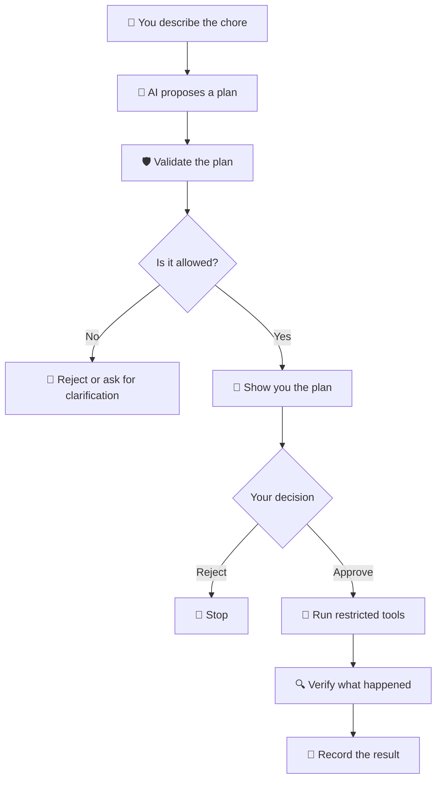
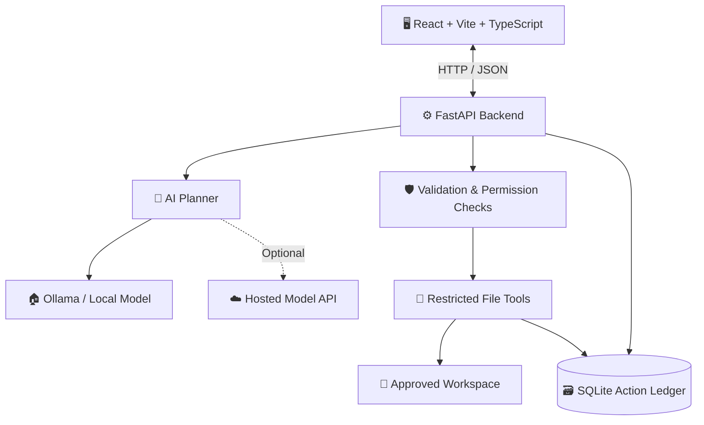

# 🦥 Idler

<p align="center">
  <Idler — Your digital housekeeper" width="100%" />
</p>

<h3 align="center">Your computer is a mess. Your sloth has a broom.</h3>

<p align="center">
  A digital housekeeper for all the computer chores you've been avoiding.
  <br />
  <i>Less mess. Less busywork. More time for absolutely anything else.</i>
</p>

<p align="center">
  🧹 File housekeeping &nbsp;·&nbsp; 🔎 Duplicate hunting &nbsp;·&nbsp; 📊 Spreadsheet checks
</p>

<p align="center">
  
  
  
  
</p>

---

## So... your downloads folder looks like this?

```text
Downloads/
├── final.pdf
├── final_FINAL.pdf
├── final_FINAL_v2.pdf
├── final_FINAL_v2_ACTUAL_FINAL.pdf
├── new_folder/
├── new_folder_2/
├── new_folder_2_REAL/
├── random_screenshot_8472.png
└── spreadsheet_use_this_please.csv
```

You needed one file.

You now have a small archaeological site.

And somewhere in that mess is the document you actually need, three copies of a spreadsheet, and a screenshot you took six months ago for reasons nobody remembers.

We've all been there.

**Idler is here to help with the little digital messes that somehow become tomorrow's problem.**

It's an AI-powered computer housekeeping assistant that takes instructions in plain English, prepares a plan, and helps carry out supported tasks with your permission.

Think of it as a tiny maid for your computer.

She has a broom. She has a plan. She is not paid enough to deal with `final_FINAL_v7_TRUSTME_REAL.pdf`.

---

## 🦥 Meet your new digital housekeeper

You tell Idler what needs doing. It figures out a possible plan, shows you what it intends to do, and waits for your approval before making supported changes.

No need to write a script for every tiny chore. No need to manually inspect every file. And definitely no need to give an AI unrestricted control of your computer.

### 💬 Things you could ask Idler

> "Please organize my Downloads folder. It's getting embarrassing."

> "Find duplicate CSV files, but don't delete anything."

> "Check this spreadsheet for missing values and duplicate rows."

> "Look through my project folder and tell me what still needs to be done."

> "Help me tidy this folder without overwriting anything."

IDLER turns requests like these into structured plans that can be checked before execution.

**You handle the important stuff. Let the sloth handle the housekeeping.**

---

## 🧹 What chores can Idler help with?

<table>
  <tr>
    <td width="50%">
      <h3>🗂️ Folder chaos</h3>
      Helps inspect and organize files inside approved folders.
      <br /><br />
      <i>For the person whose Downloads folder has become a lifestyle.</i>
    </td>
    <td width="50%">
      <h3>🔎 Duplicate hunting</h3>
      Finds exact duplicate files using hashes rather than guessing from filenames.
      <br /><br />
      <i>Because four copies of the same file are not a backup strategy.</i>
    </td>
  </tr>
  <tr>
    <td width="50%">
      <h3>📊 Spreadsheet triage</h3>
      Checks CSV files for missing values, duplicate rows, malformed rows and common data inconsistencies.
      <br /><br />
      <i>For spreadsheets held together by hope.</i>
    </td>
    <td width="50%">
      <h3>🧑‍💻 Project housekeeping</h3>
      Inspects project folders, README files and TODO lists.
      <br /><br />
      <i>For the projects you swear you'll finish this weekend.</i>
    </td>
  </tr>
  <tr>
    <td width="50%">
      <h3>↩️ Undo the oops</h3>
      Tracks supported changes and provides guarded undo for reversible operations.
      <br /><br />
      <i>Because "wait, not that file" is a universal language.</i>
    </td>
    <td width="50%">
      <h3>🧾 Keep track of things</h3>
      Records supported actions and their outcomes in a local action ledger.
      <br /><br />
      <i>Receipts for your housekeeping adventures.</i>
    </td>
  </tr>
</table>

> **A quick reality check:** Idler is under development. These are the intended capabilities of the project; what you can use today depends on the features implemented in the current version.

---

## 🧠 The AI has a brain. It does not get the house keys.

Giving an AI unrestricted access to your computer sounds convenient right up until it misunderstands one sentence and reorganizes something you really needed.

So Idler separates **understanding a request** from **having permission to execute it**.

Here's the idea:



### The house rules

- **AI suggests.** It interprets your request and proposes actions.
- **Code checks.** Deterministic rules enforce the permissions and safety requirements.
- **You approve.** The model cannot approve its own plan.
- **Tools act.** Only supported, restricted operations can execute.
- **IDLER verifies.** It checks the result instead of trusting the model's word.

The important part is that the safety rules live in the application itself, not just in a prompt telling the model to behave.

The sloth may be a little confused sometimes. The file permissions shouldn't be.

---

## 🔐 Privacy: no need to air your digital laundry

Your computer contains more than files. It might contain personal documents, private work, passwords, or information you wouldn't send to a stranger.

Idler is designed around a **local-first approach**.

| Feature | What it means |
|---|---|
| 🏠 Local AI option | Run a compatible model using Ollama on your own computer. |
| 🔒 Approved workspaces | Restrict file operations to configured folders. |
| 🧮 Local processing | Perform supported file checks, such as exact duplicate detection, locally. |
| 🧾 Local records | Keep supported action history in a local SQLite database. |
| ☁️ Optional cloud AI | Explore hosted models using your own API key, with clear privacy trade-offs. |

### What about cloud AI?

Idler may support providers such as Groq as an optional alternative to local inference.

That can make setup easier for people who don't want to download a model, but prompts sent to a hosted provider leave their computer.

The plan is to minimize outgoing data, avoid sending entire files unnecessarily, protect API keys, and add privacy checks before cloud requests.

Local-first is a design goal, not a magical promise that every configuration has zero data exposure.

**Your files are your business. The sloth doesn't gossip.**

---

## 🏗️ Under the hood

Idler uses a frontend, a Python backend, an AI planning layer, restricted tools, and local storage.



### The tech stack

| Technology | Job |
|---|---|
| React, Vite, TypeScript | The user interface |
| Python, FastAPI | Backend APIs and task handling |
| Pydantic | Structured input and plan validation |
| Ollama | Optional local AI inference |
| SQLite | Local task and action records |
| Pytest | Automated tests for application behaviour |

The idea is to keep the system understandable and lightweight rather than building a giant infrastructure just to sort a few files.

No elaborate cloud architecture required for the basic housekeeping jobs.

---

## 🧪 Give the sloth a practice run

Before letting Idler near your actual files, start with a sample workspace.

Here's a good first task:

> "Organize the sample folder by file type and find exact duplicate CSVs. Do not delete anything."

A successful test should let you:

1. Inspect the proposed plan.
2. Review the files that may be affected.
3. Approve or reject supported changes.
4. Check the resulting files.
5. Review the recorded outcome.

Start small. Use disposable test files. Don't begin by pointing an experimental tool at your entire home directory.

Even a sloth needs training.

---

## 🚀 Getting started

### What you'll need

- Git
- Python compatible with the backend's dependencies
- Node.js compatible with the frontend
- Ollama, if using local AI
- A little patience for a project that's still growing

### 1. Clone the repository

```bash
git clone https://github.com/Kaashviw3spaces/Idler.git
cd Idler
```

### 2. Prepare the backend

```bash
python3 -m venv backend/venv
source backend/venv/bin/activate

pip install -r backend/requirements.txt
```

Start the API using the project's configured entry point. For a layout that exposes `backend.app.main:app`, the command is:

```bash
python3 -m uvicorn backend.app.main:app --reload --port 8000
```

If your checkout uses a different module path, follow the entry point defined in the repository.

### 3. Start the frontend

Open another terminal:

```bash
cd frontend
npm install
npm run dev
```

Open the local URL printed by Vite.

### 4. Add local AI (optional)

Install [Ollama](https://ollama.com/) and download the model configured for IDLER.

For example, if the planner is configured to use Gemma 2B:

```bash
ollama pull gemma2:2b
```

Make sure the selected model matches your application's configuration.

> **Developer note:** Verify the module paths, seed scripts, dependency files and model settings in your checkout before treating these commands as a tested installation guide.

---

## 🛡️ Safety isn't an optional accessory

Idler is meant to help with real computer files. That means a mistaken action can have real consequences.

The design prioritizes:

- Canonical path checks and protection against path traversal.
- Rechecking permissions immediately before file changes.
- Destination collision checks and no silent overwrites.
- Explicit approval before supported state-changing operations.
- No unrestricted shell commands generated by the model.
- No automatic permanent deletion.
- An action ledger and guarded undo for supported operations.

These controls reduce risk, but they cannot eliminate every possible bug or attack. The current implementation and its tests determine which protections are actually enforced.

If you're contributing a new file operation, test the boring edge cases. Those are usually the ones that matter.

---

## 🗺️ The housekeeping roadmap

The long-term idea is a small, friendly desktop companion that quietly takes care of repetitive computer chores without quietly taking over your computer.

- [ ] 🖥️ A polished native-feeling desktop and menu bar experience.
- [ ] 🦥 A recognizable sloth-maid mascot and a friendlier interface.
- [ ] 🧠 More reliable task planning and clearer explanations.
- [ ] 🔐 Better privacy filtering for optional cloud AI.
- [ ] 🧹 More useful housekeeping tasks.
- [ ] 🔁 Saved routines for repetitive jobs.
- [ ] 🧪 More tests for failure cases and recovery.
- [ ] 📦 Easier installation for non-technical users.

These are development goals, not claims that every item is already implemented.

---

## 🤝 Help us keep the digital mess under control

Idler is an open-source project, and contributions are welcome.

You could help by:

- Reporting bugs or confusing behaviour.
- Improving documentation.
- Adding tests for safety-critical operations.
- Building new housekeeping tools.
- Improving the UI or mascot.
- Helping make local AI setup less intimidating.

### Want to contribute?

1. Fork the repository.
2. Create a branch for your change.
3. Make your changes and add relevant tests.
4. Open a pull request explaining what you improved.

Please use disposable test files. Never include private documents, API keys, or personal data in issues or test fixtures.

---

## 📜 License

Idler is distributed under the MIT License, provided the repository's `LICENSE` file confirms this.

---


---

## 📦 Official Releases & Downloads (v0.2.1)

> **Zero-Dependency Native Desktop Binaries with Embedded Standalone Backend (PyInstaller) & Auto-Updates**  
> *Runs out-of-the-box on any computer without requiring Python, Node.js, or external dependencies.*

### 🪟 Windows (10 / 11 64-bit)

| Package | Download Link | Type | Description |
|---|---|---|---|
| **Installer (Recommended)** | [📥 **`Idler.Setup.0.2.1.exe`**](https://github.com/Kaashviw3spaces/Idler/releases/download/v0.2.1/Idler.Setup.0.2.1.exe) | `.exe` | One-click setup installer with Start Menu & System Tray integration |
| **Portable Executable** | [📥 **`Idler.0.2.1.exe`**](https://github.com/Kaashviw3spaces/Idler/releases/download/v0.2.1/Idler.0.2.1.exe) | `.exe` | Single-file portable executable — run immediately with zero installation |
| **Portable ZIP** | [📥 **`Idler-0.2.1-win.zip`**](https://github.com/Kaashviw3spaces/Idler/releases/download/v0.2.1/Idler-0.2.1-win.zip) | `.zip` | Standalone unpacked folder archive |

**Windows Instructions:**
1. Download **`Idler.Setup.0.2.1.exe`** (or **`Idler.0.2.1.exe`**).
2. Launch the application. Idler will appear immediately in your bottom-right **Windows System Tray** (next to the clock).
3. Click the sloth tray icon to open the popover menu, sort loose files, and preview items!

---

### 🍏 macOS (Apple Silicon / arm64)

| Package | Download Link | Type | Description |
|---|---|---|---|
| **DMG Installer (Recommended)** | [📥 **`Idler-0.2.1-arm64.dmg`**](https://github.com/Kaashviw3spaces/Idler/releases/download/v0.2.1/Idler-0.2.1-arm64.dmg) | `.dmg` | Native drag-and-drop disk image installer |
| **ZIP Archive** | [📥 **`Idler-0.2.1-arm64-mac.zip`**](https://github.com/Kaashviw3spaces/Idler/releases/download/v0.2.1/Idler-0.2.1-arm64-mac.zip) | `.zip` | Standalone portable `.app` bundle |

**macOS Instructions:**
1. Download **`Idler-0.2.1-arm64.dmg`** (or unzip `Idler-0.2.1-arm64-mac.zip`).
2. Drag `Idler.app` into your `/Applications` folder.
3. If macOS Gatekeeper alerts on first launch, run:
   ```bash
   xattr -cr /Applications/Idler.app
   ```
4. Click the cozy sloth icon in your top macOS Menu Bar!

---

### 🔒 Cryptographic Checksums (SHA-256)

```text
daf7742978efd2bed77f1f1e4f49265f7844f4eca663ab1d056bb19f91f99610  Idler.Setup.0.2.0.exe
9b24b679b5bdf8fed9835f26f24c99176fd75de022738ac5bc9f605266124eec  Idler.0.2.0.exe
ba5fd7190d154c2d02c45da6cf91a250558726e8353f2d32fb64a41bee452ca2  Idler-0.2.0-win.zip
0d0591302081e7da0bc3e0f467fe5273db58cbb9fbdf559b32c283cfc828e30e  Idler-0.2.0-arm64.dmg
d68a346fb0e0ff126b4d635fd2286553c63d657d06b6c132654d85f286ddf369  Idler-0.2.0-arm64-mac.zip
```

#### v0.2.1 Checksums
```text
e319a89b42c9cbe4096a488c37c1c0fd636ea6af132bdd4ed38bbb9532e1b822  Idler.Setup.0.2.1.exe
cc2815a320b826c58b33c94307155e416f2274d4547bad2d9f2dc39c3105fde0  Idler.0.2.1.exe
ce4aa8bb76dc954c3ccb977761f2ab734c8d6b823ffd78c8892bdf212a7b15ab  Idler-0.2.1-win.zip
cc919031ed9e76a5018b7bfa2d8cc429e5df2d69066d85621d57cb9620bd80fe  Idler-0.2.1-arm64.dmg
9269b2082a4a0c806e17170b8b753d5786092422b7f8b9d3f87a64f5fc68c1ad  Idler-0.2.1-arm64-mac.zip
```

---

## 📦 Official Releases & Downloads (v0.2.2)

> **Screen Record Mode / Window Pinning, Sloth Mascot in Menu & Always-On-Top Recording Support**  
> *Keeps the Idler sloth menu completely visible during screen recordings (OBS, QuickTime, macOS Cmd+Shift+5, CleanShot, Loom). Includes one-click `PIN` / `REC` header toggle, `Cmd+P` shortcut, and right-click system tray menu toggle!*

### 🪟 Windows (10 / 11 64-bit)

| Package | Download Link | Type | Description |
|---|---|---|---|
| **Installer (Recommended)** | [📥 **`Idler.Setup.0.2.2.exe`**](https://github.com/Kaashviw3spaces/Idler/releases/download/v0.2.2/Idler.Setup.0.2.2.exe) | `.exe` | One-click setup installer with Start Menu & System Tray integration |
| **Portable Executable** | [📥 **`Idler.0.2.2.exe`**](https://github.com/Kaashviw3spaces/Idler/releases/download/v0.2.2/Idler.0.2.2.exe) | `.exe` | Single-file portable executable — run immediately with zero installation |
| **Portable ZIP** | [📥 **`Idler-0.2.2-win.zip`**](https://github.com/Kaashviw3spaces/Idler/releases/download/v0.2.2/Idler-0.2.2-win.zip) | `.zip` | Standalone unpacked folder archive |

**Windows Instructions:**
1. Download **`Idler.Setup.0.2.2.exe`** (or **`Idler.0.2.2.exe`**).
2. Launch the application. Idler will appear in your **Windows System Tray** (bottom right, next to the clock).
3. Click the sloth tray icon to open Idler. Toggle **`PIN`** in the header or right-click to enable **Screen Record Mode** to keep it displayed while recording!

---

### 🍏 macOS (Apple Silicon / arm64)

| Package | Download Link | Type | Description |
|---|---|---|---|
| **DMG Installer (Recommended)** | [📥 **`Idler-0.2.2-arm64.dmg`**](https://github.com/Kaashviw3spaces/Idler/releases/download/v0.2.2/Idler-0.2.2-arm64.dmg) | `.dmg` | Native drag-and-drop disk image installer |
| **ZIP Archive** | [📥 **`Idler-0.2.2-arm64-mac.zip`**](https://github.com/Kaashviw3spaces/Idler/releases/download/v0.2.2/Idler-0.2.2-arm64-mac.zip) | `.zip` | Standalone portable `.app` bundle |

**macOS Instructions:**
1. Download **`Idler-0.2.2-arm64.dmg`** (or unzip `Idler-0.2.2-arm64-mac.zip`).
2. Drag `Idler.app` into your `/Applications` folder.
3. If macOS Gatekeeper alerts on first launch, run:
   ```bash
   xattr -cr /Applications/Idler.app
   ```
4. Click the cozy sloth icon in your top macOS Menu Bar!
5. **Screen Recording:** Click **`PIN`** in the top header or right-click the sloth icon and check **`📌 Keep Window Open (Screen Record Mode)`** (or press `Cmd+P`) so Idler stays 100% visible on screen while recording!

---

### 🔒 Cryptographic Checksums (SHA-256)

#### v0.2.2 Checksums
```text
af75bf3cceb2bf46e4e1d1648caa7e6fdecdd4934ffcd2450be47b8da883e2d3  Idler.Setup.0.2.2.exe
1d4405f4e97bf834689dffaa0452bc39cec1a956ec9fd48f152f828ebbfda972  Idler.0.2.2.exe
67fee9672838e141425cf6343d37312182076eef3f1c38c6308878629f4f9f50  Idler-0.2.2-win.zip
b7c58075bfce16f4180e306125f06b29196cdfc4512674c27a89c5a1625d6eed  Idler-0.2.2-arm64.dmg
0d94e0d585b7c36fc58f32a4415d060e799bc584731ba91856f00f571079b946  Idler-0.2.2-arm64-mac.zip
```

---

## 📦 Official Releases & Downloads (v0.2.3)

> **Seamless In-App Auto-Updates (Zero-Redownload), Automatic Background Downloader & Instant Restart**  
> *Users never need to manually download or reinstall updates again! Idler automatically checks GitHub Releases, downloads updates with live percentage indicators, and applies them seamlessly with 1-click restart on both macOS & Windows.*

### 🪟 Windows (10 / 11 64-bit)

| Package | Download Link | Type | Description |
|---|---|---|---|
| **Installer (Recommended)** | [📥 **`Idler.Setup.0.2.3.exe`**](https://github.com/Kaashviw3spaces/Idler/releases/download/v0.2.3/Idler.Setup.0.2.3.exe) | `.exe` | One-click setup installer with Start Menu, System Tray & Background Auto-Updates |
| **Portable Executable** | [📥 **`Idler.0.2.3.exe`**](https://github.com/Kaashviw3spaces/Idler/releases/download/v0.2.3/Idler.0.2.3.exe) | `.exe` | Single-file portable executable — run immediately with zero installation |
| **Portable ZIP** | [📥 **`Idler-0.2.3-win.zip`**](https://github.com/Kaashviw3spaces/Idler/releases/download/v0.2.3/Idler-0.2.3-win.zip) | `.zip` | Standalone unpacked folder archive |

---

### 🍏 macOS (Apple Silicon / arm64)

| Package | Download Link | Type | Description |
|---|---|---|---|
| **DMG Installer (Recommended)** | [📥 **`Idler-0.2.3-arm64.dmg`**](https://github.com/Kaashviw3spaces/Idler/releases/download/v0.2.3/Idler-0.2.3-arm64.dmg) | `.dmg` | Native drag-and-drop disk image installer |
| **ZIP Archive** | [📥 **`Idler-0.2.3-arm64-mac.zip`**](https://github.com/Kaashviw3spaces/Idler/releases/download/v0.2.3/Idler-0.2.3-arm64-mac.zip) | `.zip` | Standalone portable `.app` bundle |

**Auto-Update Note:**
Once installed, future releases are downloaded in the background automatically. Whenever a new version is published, an in-app banner with `[Restart]` will prompt you to apply it in 1 click!


